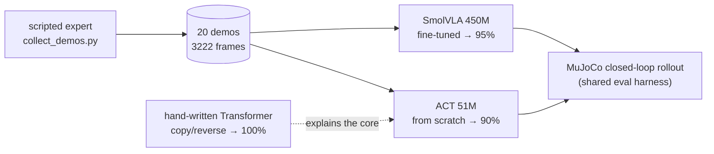
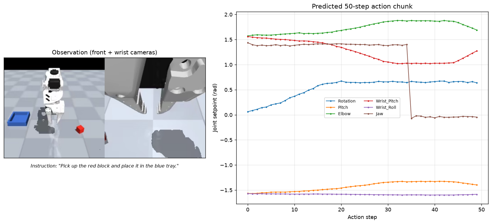
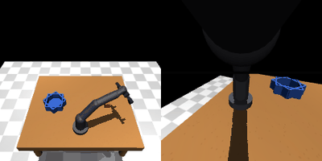

# SmolVLA + ACT: embodied learning on a single pick-and-place task

This repo runs the full *sim2sim* loop on one MuJoCo task — *"pick up the red block and
place it in the blue tray"* with an SO-ARM100 arm — end to end: collect scripted demos,
train two very different policies on them (a 450M **VLA** and a 51M **ACT**), roll each
out closed-loop, and re-implement the underlying **Transformer** from scratch so the ACT
result isn't a black box.

## At a glance



| policy | params | closed-loop success |
|---|---|---|
| SmolVLA — fine-tuned on 20 scene demos | 450M (~100M trained) | **19/20 (95%)** |
| ACT — from scratch | 51.6M | **18/20 (90%)** |
| SmolVLA — base model, transferred (no fine-tune) | 450M | 0/5 (0%) |

---

## The SmolVLA demo (where it started)

A minimal, self-contained demo of running **SmolVLA** — a 450M-parameter
**Vision-Language-Action (VLA)** model — to turn a natural-language instruction plus a
camera observation into a 50-step robot action trajectory.

Given the instruction *"Pick up the red block and place it in the blue tray."* and one
observation (two camera views + 6-DoF joint state of an SO-ARM100 arm), the policy
outputs a 50-step joint-space action chunk:



## What this demonstrates

VLAs are the current frontier of *generalist* robot policies: a single network that
accepts images + text and directly regresses motor commands, instead of a hand-engineered
perception→planning→control stack. This demo walks through the full inference path:

1. **Load** a fine-tuned SmolVLA checkpoint (450M params).
2. **Condition** it on a language instruction and a real observation.
3. **Roll out** a 50-step action chunk via flow-matching denoising.
4. **Un-normalize** the raw network output back into physical joint setpoints.

The model is [ahmedsohail2003/smolvla-so101-pickplace](https://huggingface.co/ahmedsohail2003/smolvla-so101-pickplace),
a SmolVLA fine-tuned (expert-only, 12k steps) on 100 MuJoCo demonstrations of an
SO-ARM100 arm performing pick-and-place. It's a *specialist* on one task, but the
interface (image + language → action) is the same one generalist VLAs use.

## Model

SmolVLA wraps a frozen **SmolVLM2-500M** vision-language backbone with a smaller
**action expert** (cross-attention into the VLM's features). At inference it generates
the next `chunk_size = 50` action steps as one batch, using `num_steps = 10` flow-matching
denoising iterations. Output is 6 joint setpoints:

`Rotation, Pitch, Elbow, Wrist_Pitch, Wrist_Roll, Jaw` (rad).

## Quick start

```bash
# 1. create + activate an environment (Python 3.11)
conda create -n lerobot python=3.11 -y && conda activate lerobot

# 2. PyTorch with CUDA (the default PyPI wheel is CPU-only)
pip install torch==2.10.0 torchvision==0.25.0 --index-url https://download.pytorch.org/whl/cu126

# 3. LeRobot + the model's extra deps
pip install lerobot==0.4.4
pip install transformers==4.50.0 huggingface-hub==0.35.3 num2words
pip install pillow matplotlib

# 4. MuJoCo (only needed for the closed-loop rollout)
pip install mujoco opencv-python

# 5. run the demo (downloads the model weights on first run)
python infer.py
```

The script writes `assets/inference_result.png`. Pass `--task` to try another
instruction, or `--device cpu` if you have no GPU:

```bash
python infer.py --task "Grab the block and move it to the tray."
```

> **Users in China:** the default HuggingFace source is often unreachable. The script
> already sets `HF_ENDPOINT=https://hf-mirror.com`; for pip use
> `-i https://pypi.tuna.tsinghua.edu.cn/simple`.

## How it works

`infer.py` does four things:

- **`ensure_model`** — downloads the checkpoint to `models/` (via `snapshot_download`)
  and patches its `config.json` for LeRobot 0.4.4 (see *Version note* below).
- **`load_sample_observation`** — loads one real observation committed under `assets/`
  (`front.png`, `wrist.png`, `state.npy`), so the demo runs without the 300 MB dataset.
- **`make_pre_post_processors`** — rebuilds the saved pre/post-processing pipelines:
  rename `front/wrist → camera1/camera2`, tokenize the instruction into
  `observation.language_tokens`, move to device, normalize state with dataset statistics.
- **`policy.predict_action_chunk`** — runs the flow-matching denoiser for `num_steps`
  iterations and returns a `(1, 50, 6)` action chunk, which the post-processor
  un-normalizes back to physical units.

The sample observation comes from the training set
([`ahmedsohail2003/so101-sim-pickplace`](https://huggingface.co/datasets/ahmedsohail2003/so101-sim-pickplace)),
extracted by `scripts/extract_sample.py` (one-time, requires `pyav` for video decode).

## Closed-loop simulation rollout

`infer.py` proves the model can turn one observation into an action chunk. To show the
same policy actually *acting* in a physics simulation, `scripts/rollout.py` runs it
**closed-loop** inside a MuJoCo SO-ARM100 scene:

```
   reset ──► observe (2 cameras + 6-dim state) ──► predict 50-step chunk
        ▲                                                          │
        └────────────── execute chunk in physics ◄─────────────────┘
                        (record video + check success)
```

```bash
python scripts/rollout.py --episodes 5            # success-rate stat
python scripts/rollout.py --episodes 1 --render-video   # + per-episode mp4
```

The environment (`envs/so101_env.py`) exposes the **exact** interface the policy was
trained on — `[shoulder_pan, shoulder_lift, elbow_flex, wrist_flex, wrist_roll, jaw]`
in radians, `front`/`wrist` 224×224 cameras — and drives a position-controlled arm with
a kinematic snap-grasp, recording success when the block lands in the tray.

### Honest result: the pipeline runs, the task does not (yet)

Across 5 episodes the policy reaches the 250-step horizon without a single success
(0/5). That is the *expected* outcome, and the demo is explicit about why:

- **The scene is not the training robot.** `assets/so101_scene.xml` is an approximate
  SO-ARM100 (different link lengths and one mirrored `elbow_flex` sign convention,
  which the env flips back). Forward kinematics therefore never match what the policy
  learned.
- **The cameras don't match.** The policy was trained on a specific simulator's `front`
  / `wrist` viewpoints; the MuJoCo scene uses a different overhead + wrist camera.
- **Confirmed by the behavior:** the policy correctly reads the 6-dim state (it
  recognizes the home pose) but outputs a *hold-position* chunk rather than a reach,
  i.e. the VLM does not detect a grasp target in the unfamiliar render.

So the value here is the **closed-loop engineering**, not the transferred success rate:
model loading → VLM inference → flow-matching denoising → action execution in physics →
video + metrics, end to end. The next section closes that domain gap.

## Fine-tuning on this scene (closing the domain gap)

The 0% above is a *transfer* failure, not a model failure: the policy was never trained
on this scene's kinematics or cameras. The fix is to teach it — collect demonstrations
**in this very scene** and fine-tune the action expert. That lifts success from 0% to
**95%**.

Three scripts do this end to end:

```bash
# 1. Collect 20 scripted pick-and-place demos into a LeRobot v3.0 dataset
python scripts/collect_demos.py --episodes 20

# 2. Fine-tune SmolVLA (expert-only) on those demos (~30 min on an RTX 3080)
python scripts/finetune_smolvla.py --steps 2500 --batch-size 2

# 3. Evaluate the fine-tuned checkpoint in the same scene
python scripts/eval_finetuned.py --episodes 20
```

**1. `collect_demos.py`** — a waypoint + Jacobian-IK scripted expert drives the arm
through pick-and-place, and every step (6-dim state, 6-dim action, front + wrist
cameras, task text) is written into `datasets/smolvla_so101_demos`. The EE is
rate-limited so each ~160-step episode exceeds SmolVLA's `chunk_size = 50`, and the
block position is jittered ±2 cm per episode for robustness.

**2. `finetune_smolvla.py`** — loads the cached base checkpoint, freezes the VLM
backbone (`train_expert_only`, `freeze_vision_encoder`), and trains only the action
expert + state/action projections (~100M of 450M params) on the new demos.
Normalization stats are re-derived from *this* dataset so the fine-tuned model matches
the scene. AdamW + cosine-warmup, bf16 autocast.

**3. `eval_finetuned.py`** — loads the fine-tuned checkpoint (with its re-normalized
pre/post processors) and runs closed-loop rollouts under the same ±2 cm jitter, scoring
success identically to the demos.

### Result

| model | success rate |
|---|---|
| base `smolvla-so101-pickplace` (transferred) | 0/5 (0%) |
| fine-tuned on 20 scene demos (2500 steps) | **19/20 (95%)** |

The fine-tuned expert reproduces the scripted trajectory in ~170 steps (vs ~160 for the
expert itself): it reaches to the block, grasps, moves to the tray, and releases. The one
failure ran out its 400-step horizon on an unlucky initial condition. This is a
*sim2sim within one simulator* result — it proves the full collect → fine-tune → deploy
loop works, not that SmolVLA generalizes to a novel scene (that needs real
cross-embodiment data).

## Training a LeRobot ACT policy from scratch

As a complement to the fine-tuned VLA, the same scene + demos also train a **LeRobot
ACT** policy (Action Chunking with Transformers, ~51.6M params) *from scratch* — a
ResNet18 image encoder + transformer encoder/decoder + CVAE latent, with no pretrained
vision or language backbone. This closes the "LeRobot ACT + robot arm" loop that
fine-tuning a pretrained VLA doesn't exercise.

```bash
# Train ACT from scratch on the 20 collected demos (~20 min on an RTX 3080)
python scripts/train_act.py --steps 3000 --batch-size 8

# Closed-loop eval in the same scene
python scripts/eval_act.py --episodes 20
```

**`train_act.py`** — builds an `ACTConfig` (`chunk_size = 100`, `use_vae = True`,
ResNet18 backbone, no ImageNet pretrained weights), infers input/output features from
the dataset, normalizes with this dataset's stats, and trains with AdamW + cosine
warmup at `lr = 1e-4`.

**`eval_act.py`** — loads the checkpoint and its saved pre/post processors, then rolls
out in the MuJoCo scene at `control_freq = 20` (matching the dataset fps), executing each
100-step chunk open-loop before re-observing.

### Result

| model | success rate |
|---|---|
| LeRobot ACT from scratch | **18/20 (90%)** |

ACT reaches, grasps, places, and releases in ~157 steps — essentially matching the
scripted expert's ~160. The two failures ran out the 400-step horizon. Like the SmolVLA
result, this is *sim2sim within one simulator*: it proves the from-scratch ACT training
loop works end to end, not cross-embodiment generalization.



*ACT policy executing pick-and-place closed-loop in MuJoCo (front + wrist views,
downsampled from a 20 Hz rollout).*

## Transformer from scratch (understanding the source)

ACT's core is a transformer encoder + decoder. `scripts/transformer_from_scratch.py`
re-implements that architecture from the ground up — scaled dot-product attention,
multi-head attention, sinusoidal positional encoding, feed-forward blocks, and the
encoder/decoder stacks — using only `nn.Linear` / `nn.LayerNorm` / `nn.Embedding`
(no `nn.Transformer`, `nn.MultiheadAttention`, or `F.scaled_dot_product_attention`).

To prove it actually learns, it trains on two tiny sequence-to-sequence tasks:

```bash
python scripts/transformer_from_scratch.py --task copy     # ~400 steps to 100%
python scripts/transformer_from_scratch.py --task reverse  # ~800 steps to 100%
```

| task | what the decoder must do | final accuracy |
|---|---|---|
| `copy` | reproduce the input digits | 100% |
| `reverse` | output the input digits in reverse order | 100% |

`reverse` is the interesting one: it can't be solved by echoing the input, so the
decoder must learn to cross-attend to the encoder memory *in the correct order* — the
exact mechanism ACT's decoder uses to turn image + joint-state tokens into an action
chunk.

## Version note (LeRobot 0.4.4 vs 0.6.0)

The community checkpoint was trained and saved with **LeRobot 0.6.0**, whose config
carries two fields that **0.4.4** rejects. `infer.py` patches them automatically:

| field | 0.6.0 value | 0.4.4 problem | patch |
|---|---|---|---|
| `pretrained_revision` | `null` | unknown field → `DecodingError` | removed |
| `load_vlm_weights` | `true` | re-downloads the 2 GB VLM backbone | set `false` (full VLM weights are already inside `model.safetensors`) |

Weight structure was verified identical between the two versions (500 keys), so the
checkpoint loads losslessly. Two more dependency traps worth knowing:

- **`transformers` must stay on 4.50.x.** SmolVLM2 support landed in 4.50.0, but 5.x
  requires `huggingface-hub>=1.31`, which conflicts with LeRobot 0.4.4's `<0.36`.
- **`num2words`** is a hidden dependency of the SmolVLM processor.

## Project structure

```
.
├── infer.py                 # load model, run language-conditioned inference, visualize
├── envs/
│   └── so101_env.py         # MuJoCo SO-ARM100 env exposing SmolVLA's exact interface
├── scripts/
│   ├── extract_sample.py    # extract one observation from the dataset -> assets/
│   ├── rollout.py           # closed-loop inference (base model) + video + metrics
│   ├── collect_demos.py     # scripted expert -> LeRobot dataset in this scene
│   ├── finetune_smolvla.py  # expert-only fine-tuning on the collected demos
│   ├── eval_finetuned.py    # closed-loop eval of the fine-tuned checkpoint
│   ├── train_act.py         # LeRobot ACT from scratch on the collected demos
│   ├── eval_act.py          # closed-loop eval of the ACT checkpoint
│   ├── transformer_from_scratch.py  # hand-written encoder-decoder Transformer
│   └── make_rollout_gif.py  # render a successful rollout to an animated GIF
├── assets/                  # committed sample observation + scene + generated files
│   ├── front.png            #   front camera view (224x224)
│   ├── wrist.png            #   wrist camera view (224x224)
│   ├── state.npy            #   6-dim joint state
│   ├── sample_meta.json     #   provenance of the sample
│   ├── so101_scene.xml      #   MuJoCo scene for the closed-loop rollout
│   ├── inference_result.png #   demo output (regenerated by infer.py)
│   └── act_rollout.gif      #   ACT closed-loop rollout (regenerated by make_rollout_gif.py)
├── outputs/
│   ├── rollout/             # base-model episode videos (gitignored)
│   ├── eval/                # fine-tuned episode videos (gitignored)
│   └── train/smolvla_so101/ # fine-tuned checkpoint (gitignored)
│   └── train/act_so101/     # ACT checkpoint (gitignored)
├── datasets/                # collected demo dataset (gitignored)
├── models/                  # base checkpoint (gitignored, downloaded on first run)
├── .gitignore
└── README.md
```

## References

- [SmolVLA paper](https://huggingface.co/papers/2506.01844) — HuggingFace
- [LeRobot](https://github.com/huggingface/lerobot) — HuggingFace
- [SmolVLM2-500M-Video-Instruct](https://huggingface.co/HuggingFaceTB/SmolVLM2-500M-Video-Instruct)
- [smolvla-so101-pickplace](https://huggingface.co/ahmedsohail2003/smolvla-so101-pickplace) — the checkpoint used here
